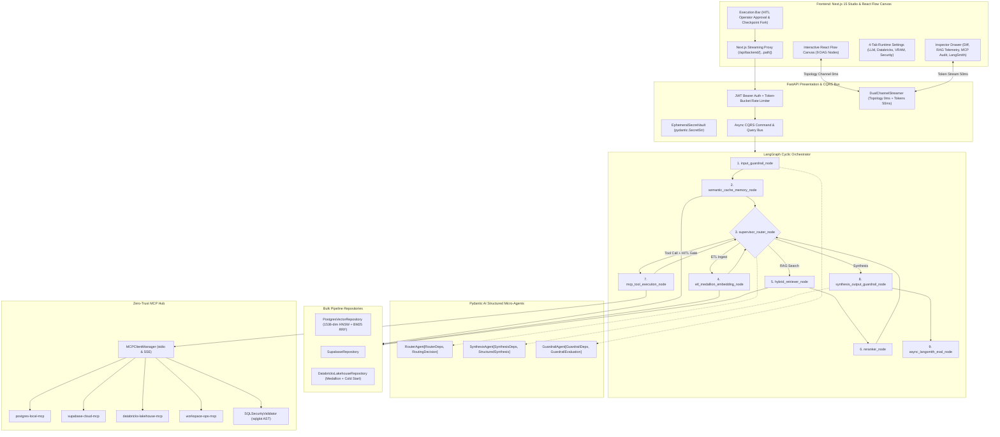

# StrataGraph Studio

<div align="center">

**Enterprise Visual Agentic Orchestration, Medallion RAG & MCP Control Plane**

[](https://github.com/orieblax/stratagraph-studio/actions/workflows/ci-cd.yml)
[](https://fastapi.tiangolo.com)
[](https://nextjs.org)
[](https://langchain-ai.github.io/langgraph/)
[](https://ai.pydantic.dev/)
[](https://reactflow.dev/)
[](https://github.com/pgvector/pgvector)
[](https://www.databricks.com)
[](LICENSE)

[Architecture](#-system-architecture) •
[Key Features](#-key-features) •
[Quickstart](#-quickstart-guide) •
[Pydantic AI & LangGraph](#-pydantic-ai--langgraph-synergy) •
[Vercel Deployment](#-vercel-deployment) •
[Verification](#-testing--verification)

</div>

---

## 🌟 Overview

**StrataGraph Studio** is an enterprise-grade control plane and visual orchestration IDE for autonomous multi-agent workflows. It combines:
- **Macro-Orchestration** via a cyclic **LangGraph** `StateGraph` with durable PostgreSQL checkpoints (`PostgresSaver`), time-travel forking, and Human-in-the-Loop (`interrupt_before`) approval gates.
- **Micro-Agent Structured Reasoning** via **Pydantic AI**, delivering type-safe outputs (`RoutingDecision`, `StructuredSynthesis`, `GuardrailEvaluation`), dependency injection (`RunContext[Deps]`), and schema validation.
- **Interactive Visual Canvas** built on **Next.js 15** and **React Flow**, featuring real-time node state glow borders, animated particle edge pulsing, and dual-channel event backpressure.
- **Medallion RAG & Lakehouse Pipelines** integrating local **PostgreSQL (`pgvector`)**, **Supabase**, and **Databricks Unity Catalog** (Volumes &rarr; Bronze &rarr; Silver &rarr; Gold Vector Search).
- **Zero-Trust Model Context Protocol (MCP) Hub** running process-isolated `stdio` MCP subprocesses with environment scrubbing and remote SSE transports.
- **Defense-in-Depth Security**: SQL AST validation via `sqlglot`, cryptographic XML spotlighting (`<untrusted_context_{nonce}>`), PII redaction, and SSRF loopback protections.
- **Two-Tier FinOps Semantic Cache & Circuit Breakers**: SHA-256 exact match ($0ms, \$0$) + `pgvector` cosine similarity ($\ge 0.92$) with loop and dollar spending breakers.

---

## 📐 System Architecture



---

## ⚡ Key Features

### 1. LangGraph + Pydantic AI Micro-Agent Synergy
- **Macro Cyclic State Machine**: LangGraph manages global state transitions, durable checkpoints, loop iteration guards, and Human-in-the-Loop interruptions.
- **Micro-Agent Execution**: Pydantic AI operates *within* graph nodes to enforce type-safe structured outputs (`RoutingDecision`, `StructuredSynthesis`), automatic JSON schema validation, and dynamic system prompts with typed dependencies (`RunContext[Deps]`).

### 2. Dual-Channel Backpressure Streaming
To prevent SVG canvas stutter during high-speed token generation:
- **`topology_event` (0ms Immediate Dispatch)**: Node transitions, glowing borders, active edge pulses, HITL pause events, and eval scores are dispatched immediately to the React Flow Zustand store.
- **`token_stream_event` (50ms Throttled Buffer)**: Generated LLM tokens are buffered and routed exclusively to the Markdown Output Drawer, preserving a smooth 60 FPS canvas experience.

### 3. Medallion Lakehouse RAG & Cold-Start Resilience
- **Unity Catalog Medallion Flow**: Maps uploaded files to Volumes (Raw) &rarr; Bronze Delta Table &rarr; Silver Delta Table (PII-redacted, SHA-256 deduplicated) &rarr; Gold / Databricks Vector Search.
- **SQL Warehouse Cold-Start Handler**: Asynchronous connection pool with exponential backoff and real-time `"Warming up SQL Warehouse..."` canvas status notifications during cluster spin-up.

### 4. Zero-Trust Model Context Protocol (MCP) Hub
- **Isolated `stdio` Subprocesses**: Scrubs `os.environ` to a strict whitelist plus scoped credentials before spawning MCP processes.
- **`sqlglot` AST Security Validator**: Enforces read-only AST parsing, blocks multi-statement queries (`;`), rejects destructive DDL/DCL (`DROP`, `TRUNCATE`, `ALTER`, `GRANT`), and clamps result sets to `LIMIT 100`.
- **Cryptographic XML Spotlighting**: Wraps retrieved context and tool outputs in `<untrusted_context_{nonce}>` boundary tags to prevent indirect prompt injection.

### 5. FinOps Semantic Cache & Hardware Guardrails
- **Tier 1 (Exact Match)**: SHA-256 hash on normalized `(prompt + config_hash)` for 0ms, \$0 responses.
- **Tier 2 (Semantic Match)**: Cosine similarity search ($\ge 0.92$) in local PostgreSQL `pgvector`.
- **VRAM Protection**: Quantized Cross-Encoder Re-Ranker runs on CPU (`onnx-int8`) by default, preserving GPU VRAM for local LLMs (e.g., Ollama).
- **FinOps Circuit Breakers**: Automatically halts execution if `loop_count > max_iterations` (default 3) or accumulated cost exceeds `max_cost_usd`.

---

## 📁 Repository Structure

```
stratagraph-studio/
├── .github/workflows/          # CI/CD: Backend SAST, Mypy, Pytest & Frontend Vercel Build
├── backend/
│   ├── Dockerfile              # Hardened non-root container with read-only rootfs
│   ├── pyproject.toml          # Strict Ruff, Mypy, Pytest & Bandit configuration
│   ├── requirements.txt        # Pinned production dependencies (FastAPI, LangGraph, Pydantic AI)
│   ├── src/
│   │   ├── main.py             # FastAPI entrypoint, CORS, security middleware & routers
│   │   ├── modules/
│   │   │   ├── orchestration/  # LangGraph StateGraph, 9 nodes, Pydantic AI agents & streaming
│   │   │   ├── rag_etl/        # Outbox chunker, hybrid search, reranker & repositories
│   │   │   ├── databricks_lakehouse/ # Unity Catalog Medallion & SQL Warehouse cold-start
│   │   │   ├── mcp_hub/        # MCPClientManager & 4 servers (postgres, supabase, databricks, ops)
│   │   │   ├── security_guardrails/  # SQL AST validator, spotlighting, PII scrubber, SSRF checks
│   │   │   └── cost_optimization/   # Two-Tier pgvector cache, model tiering router & circuit breakers
│   │   └── shared/             # Strategy Registry, EphemeralSecretVault, CQRS bus & logging
│   └── tests/                  # 63 unit and full integration tests
├── docker/
│   └── postgres/init.sql       # 1536-dim HNSW cosine index, GIN tsvector & outbox tables
├── docker-compose.yml          # Multi-container topology (pgvector + backend + host-bridged Ollama)
├── docs/                       # Architectural guides & Vercel deployment documentation
├── frontend/
│   ├── src/
│   │   ├── app/                # Next.js 15 App Router, layout, page, health & proxy routes
│   │   ├── components/         # React Flow canvas, custom nodes, glowing edges, drawers & controls
│   │   ├── services/           # API client with zero-CORS streaming proxy support
│   │   ├── store/              # Decoupled Zustand stores (topology vs. token stream vs. config)
│   │   └── types/              # Comprehensive TypeScript interfaces
│   ├── vercel.json             # Vercel deployment configuration & CSP security headers
│   └── vitest.config.mts       # Vitest configuration for component & store tests
├── package.json                # Root monorepo workspace scripts
├── scripts/                    # Cross-platform Vercel deployment automation (PowerShell & Bash)
└── vercel.json                 # Monorepo root Vercel configuration
```

---

## 🚀 Quickstart Guide

### Prerequisites
- **Docker & Docker Compose** (for PostgreSQL `pgvector`)
- **Python 3.12+** (Backend)
- **Node.js 20+** & **npm** (Frontend)

### 1. Clone the Repository
```bash
git clone https://github.com/orieblax/stratagraph-studio.git
cd stratagraph-studio
```

### 2. Configure Environment Variables
Copy the example environment files:
```bash
cp .env.example .env
cp frontend/.env.example frontend/.env.local
```

### 3. Start PostgreSQL (`pgvector`)
```bash
docker compose up -d postgres-pgvector
```
This initializes PostgreSQL 16 on port `5432` with `vector`, `pg_trgm`, `uuid-ossp`, and creates all required tables and 1536-dim HNSW cosine indexes.

### 4. Start the FastAPI Backend
```bash
cd backend

# Create and activate virtual environment
python -m venv .venv
source .venv/bin/activate       # On Linux/macOS
# .\.venv\Scripts\Activate.ps1  # On Windows PowerShell

# Install dependencies
pip install -r requirements.txt

# Start FastAPI server
uvicorn src.main:app --host 127.0.0.1 --port 8000 --reload
```
Interactive Swagger documentation is available at **http://127.0.0.1:8000/docs**.

### 5. Start the Next.js 15 Studio Frontend
In a new terminal window:
```bash
cd frontend
npm install
npm run dev
```
Open **http://localhost:3000** to access the interactive React Flow canvas.

---

## 🤖 Pydantic AI & LangGraph Synergy

StrataGraph Studio unites **LangGraph** and **Pydantic AI** into an enterprise macro/micro pattern:

```python
# 1. Macro Orchestration (LangGraph StateGraph)
workflow = StateGraph(AgentState)
workflow.add_node("supervisor_router_node", supervisor_router_node)
workflow.add_node("synthesis_output_guardrail_node", synthesis_output_guardrail_node)
workflow.compile(checkpointer=MemorySaver(), interrupt_before=["mcp_tool_execution_node"])

# 2. Micro-Agent Structured Reasoning (Pydantic AI)
# Inside supervisor_router_node:
router_agent = create_router_agent(provider="openai")
decision: RunResult[RoutingDecision] = await router_agent.run(
    query, 
    deps=RouterDeps(user_query=query, loop_count=1, accumulated_cost_usd=0.02)
)
# Returns validated RoutingDecision(target_node="hybrid_retriever_node", confidence=0.95, ...)

# Inside synthesis_output_guardrail_node:
synth_agent = create_synthesis_agent(provider="openai")
synthesis: RunResult[StructuredSynthesis] = await synth_agent.run(prompt, deps=synth_deps)
# Returns validated StructuredSynthesis(summary=..., detailed_answer=..., citations=[...])
```

---

## ☁️ Vercel Deployment

StrataGraph Studio uses a **Zero-CORS Streaming Reverse Proxy** architecture for production:
- **Frontend**: Deployed on **Vercel** (`frontend/`).
- **Backend**: Deployed on container infrastructure (**Railway**, **Render**, **Fly.io**, or **Cloud Run**).
- **Database**: Managed **Supabase** or **Neon** PostgreSQL with `pgvector`.

### One-Click Git Integration via Vercel
1. Import the repository into [vercel.com/new](https://vercel.com/new).
2. Set Environment Variables:
   - `NEXT_PUBLIC_BACKEND_URL`: `https://api.your-backend.com`
   - `BACKEND_URL`: `https://api.your-backend.com`
3. Click **Deploy**.

### CLI Deployment Helper
Deploy directly from your terminal using the included automation script:
```powershell
# PowerShell (Windows)
.\scripts\deploy-vercel.ps1 -Production -BackendUrl "https://api.your-backend.com"

# Bash (Linux/macOS)
./scripts/deploy-vercel.sh --prod
```

For full setup details, see the [Vercel Deployment Guide](docs/vercel-deployment.md).

---

## 🧪 Testing & Verification

Every component is governed by automated test suites, static analysis, and SAST security scans.

### Backend Verification (63 Tests)
```bash
cd backend

# 1. Code Style & Linting (Ruff)
ruff check src tests

# 2. Strict Static Type Analysis (Mypy)
mypy --strict src

# 3. Security Vulnerability Scan (Bandit SAST)
bandit -r src -ll

# 4. Pytest Suite (Unit & Integration)
pytest tests -v
```

### Frontend Verification (9 Tests + Production Build)
```bash
# Run from repository root or inside frontend/
npm run lint --prefix frontend        # ESLint check
npm run typecheck --prefix frontend   # TypeScript strict check
npm run test:frontend                 # Vitest component & store tests
npm run build                         # Next.js 15 production build
```

---

## 🛡️ Security Architecture

| Security Layer | Mechanism | Protection |
| :--- | :--- | :--- |
| **SQL Injection** | `sqlglot` AST Parsing | Blocks multi-statement queries, DDL/DCL, enforces schema allowlist, appends `LIMIT 100` |
| **Indirect Injection** | Cryptographic Nonces | Wraps untrusted text in `<untrusted_context_{nonce}>` boundary tags |
| **Data Exfiltration** | Taint Tracking & HITL | Tainted context automatically halts before side-effect tools (`send_email`, SQL writes) |
| **Credential Hygiene** | Ephemeral `SecretStr` Vault | API keys passed in request headers; never stored in checkpoints or LangSmith |
| **SSRF / File Poisoning** | MIME Magic Inspection | Inspects file headers, limits decompression ratios, blocks private/loopback IP ranges |
| **Transport Security** | Streaming Proxy & CSP | Zero-CORS Next.js route handler, strict CSP headers (`connect-src`, `frame-ancestors 'none'`) |

---

## 📄 License

StrataGraph Studio is licensed under the [Apache License, Version 2.0](LICENSE).
